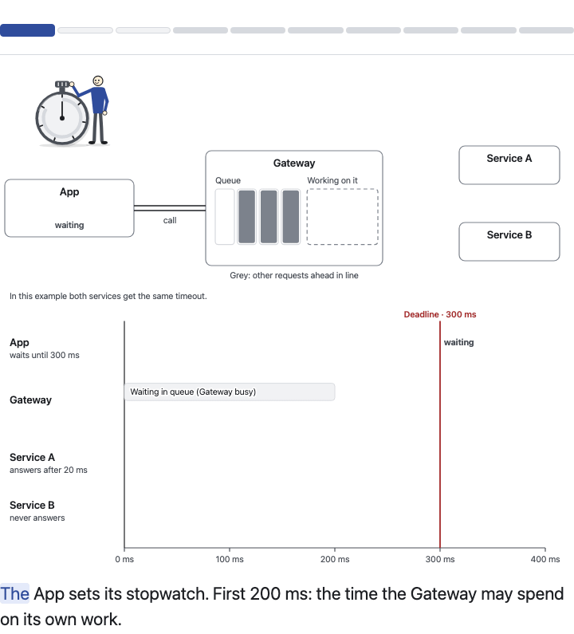

# Narrated Explainer

Turn any material into a short animated film that plays in the browser: an SVG story with a
natural voice, sound effects, captions that highlight word by word, and full playback controls.
The result is **one HTML file that works offline**. Everything runs on your machine with
open-source tools; no cloud service, account or API key is involved.

It ships as an **agent skill**: give Claude Code or Codex a document, notes or an idea, ask for
a narrated explainer, and the agent storyboards it, draws it with the kit, records the voice,
checks every frame and hands you the file.



**Demo:** [`docs/demo/deadline-race.html`](docs/demo/deadline-race.html) (download it and open it
in a browser, then press Play) and [`docs/demo/deadline-race-after.mp4`](docs/demo/deadline-race-after.mp4)
(the "After" mode as a video with sound).

## What you get

- **Animation kit**: boxes, arrows, travelling tokens, queues, speech bubbles, readouts, stamps,
  meters, time axes, and a mechanical stopwatch wound by a little figure. Light and dark themes.
- **Narration**: every caption is recorded with [Kokoro](https://huggingface.co/hexgrad/Kokoro-82M),
  then transcribed with [faster-whisper](https://github.com/SYSTRAN/faster-whisper) and compared
  with the script. A clip that does not say what the caption says is recorded again or fails the
  build.
- **Sound effects** synthesised in the browser (click, pop, whoosh, tick, ding, success, fail,
  alarm, wind, thud), so they cost no files and no licences.
- **The flow**: an optional intro, key moments where the story pauses until the narrator has
  finished, and an optional Before/After comparison on the same timeline.
- **Controls**: Play/Pause, Restart, Previous/Next moment, speed, voice and sound toggles, a
  progress bar with one marker per moment, a transcript, fullscreen, and keyboard shortcuts.
  Nothing plays until the viewer clicks, and reduced-motion settings are respected.
- **Proof for the author**: `explainer snapshots` saves a PNG of every moment so an agent (or
  you) can look at each frame, and `explainer check` rejects files that would load anything from
  the network.
- **Video**: `explainer video` renders a frame-exact MP4 with the soundtrack, or a silent GIF.

## Install

macOS or Linux, with `curl` (or `wget`) and about 1 GB of free disk:

```bash
git clone https://github.com/ohade/narrated-explainer.git
cd narrated-explainer
./setup.sh
```

`setup.sh` installs [uv](https://github.com/astral-sh/uv) if it is missing, uses it to install
Python 3.12 and every dependency (no system Python needed), puts the `explainer` command on your
PATH, downloads and hash-checks the voice and speech models (about 480 MB), installs a headless
Chromium for snapshots and video, links the skill into Claude Code and Codex when they are
installed, and finishes with a real record-and-check smoke test. Running it again changes nothing.

Options: `--no-browser` skips Chromium; `--skill auto|claude|codex|all|none` chooses where the
skill is linked (default `auto`). Windows: `.\setup.ps1` (experimental, not yet tested on a real
Windows machine).

Check the install at any time with `explainer doctor`.

## Use it with an agent

After setup, ask your agent in plain words:

> Make a narrated explainer of `docs/how-caching-works.md` for new team members.

The skill (`skills/narrated-explainer/SKILL.md`) guides the agent through: understanding the
material, a storyboard, `story.json` and `scene.js`, recording, building, and looking at every
snapshot before handing over the file.

**Claude Code** can also install it as a plugin:

```text
/plugin marketplace add ohade/narrated-explainer
/plugin install narrated-explainer@narrated-explainer
```

## Use it by hand

```bash
explainer new my-story          # a starter: story.json + scene.js
# edit my-story/story.json (the words) and my-story/scene.js (the drawing)
explainer narrate my-story      # record and check every caption
explainer build my-story        # my-story/dist/<id>.html
explainer check my-story        # story rules, stale narration, no network calls
explainer snapshots my-story    # one PNG per moment in my-story/dist/snapshots/
explainer video my-story        # MP4 with the soundtrack (--format gif for a silent GIF)
```

`explainer build my-story --fragment` writes just the figure, ready to paste into another page.

A story is two files:

- `story.json` holds every word: title, modes, timing, the intro steps and the moments, each with
  a caption and an optional sound cue. The captions are the narration script.
- `scene.js` holds a pure model `stateAt(mode, t)` and the drawing. Because everything on screen
  is derived from the model, playback, stepping backwards, snapshots and video always agree.

Start with [`docs/architecture.md`](docs/architecture.md) (the full contract) and
[`skills/narrated-explainer/references/scene-authoring.md`](skills/narrated-explainer/references/scene-authoring.md)
(the kit API and patterns). The demo lives in [`examples/deadline-race/`](examples/deadline-race/).

## Voices

The default voice is Kokoro `am_michael`. Change it per story:

```json
"voice": { "engine": "kokoro", "voice": "af_heart", "speed": 1.0 }
```

To use another local model (for example Chatterbox for more expressive speech), run any local
server that speaks the OpenAI `/v1/audio/speech` API and set `"engine": "http"`, then
`explainer narrate my-story --url http://127.0.0.1:8880/v1/audio/speech`.

## Why these tools

Every choice and every rejected alternative (voices, speech checkers, sound and music models,
animation libraries, export paths) is recorded with its licence in [`docs/tools.md`](docs/tools.md).
In short: the defaults are permissive, run on a CPU, and install without system packages.

## Development

```bash
node --test src/narrated_explainer/runtime/tests/*.test.mjs examples/*/*.test.mjs
uv run pytest -q -m "not slow"     # fast tests
uv run pytest -q -m slow           # real voice and speech models
```

The runtime is plain JavaScript with no build step and no dependencies. The build tool is a uv
Python project.

## Licence

MIT for everything in this repository. The default models are Kokoro-82M (Apache-2.0) and
Whisper `base.en` (MIT). The voice stack installs eSpeak NG and phonemizer (GPL-3.0) on your
machine to turn text into phonemes, and video export uses an LGPL/GPL ffmpeg build from
`imageio-ffmpeg`; none of them is part of this repository.
